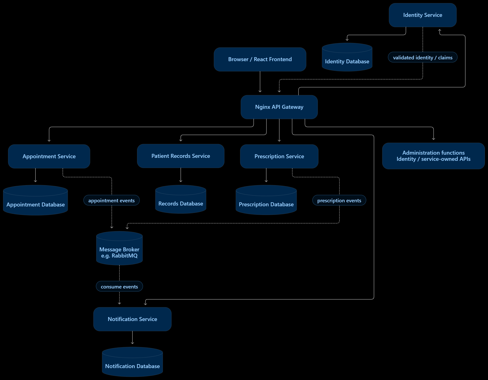

# HealthCarePlus
## Healthcare Management Platform

> **Architecture status:** Proposed conceptual design for the group project. The microservices shown are recommendations, not claims that backend services are already implemented or deployed.



## 1. Project Overview

HealthCarePlus is a healthcare management platform concept for patients, doctors, and administrators. The current frontend screens include login/signup, patient and doctor dashboards, appointment booking, medical records, prescriptions, notifications, and administration.

The goal is to provide an organized user experience for common healthcare workflows while separating backend responsibilities into services that can be developed and maintained independently.

## 2. Proposed Microservices

| Service | Responsibility | Example capabilities |
|---|---|---|
| **Identity Service** | User identity and authentication | Registration, sign-in, account lifecycle, token/role claims |
| **Appointment Service** | Appointment scheduling and lifecycle | View appointment options, book/request, reschedule/cancel under policy |
| **Patient Records Service** | Authorized clinical record management | View permitted patient records |
| **Prescription Service** | Prescription lifecycle | Create/update and view prescriptions according to access policy |
| **Notification Service** | Notification processing | Appointment confirmations, reminders, notification status |
| **Admin capabilities** | Administration actions | Owned by Identity or the relevant domain service |

### Architecture notes

1. **Frontend:** React UI calls backend endpoints through the gateway.
2. **API Gateway:** Nginx is proposed for routing/reverse proxying. It is not the only security boundary.
3. **Service-owned data:** Each service owns its business logic and data. Other services should not directly query its database.
4. **Synchronous calls:** Suitable for request/response workflows such as viewing appointments or permitted records.
5. **Asynchronous events:** A message broker such as RabbitMQ may carry appointment/prescription events for notification processing. Define retries, idempotency, and event schemas.
6. **Security:** Every service must validate identity and enforce its own authorization rules. UI route guards alone are not sufficient.
7. **Privacy:** Apply least privilege, protect data in transit and at rest, and audit sensitive clinical-record access. Use synthetic data for demos.

## 3. Proposed Project Structure

This is a recommended repository layout for the team, not a snapshot of the existing implementation.

```text
HealthCarePlus/
├── README.md
├── docs/
│   ├── images/
│   │   └── healthcareplus-architecture.png
│   ├── architecture/
│   └── decisions/
├── frontend/
│   └── src/
│       ├── components/
│       ├── pages/
│       ├── api.js
│       ├── auth.jsx
│       └── main.jsx
├── gateway/
│   └── nginx.conf
├── services/
│   ├── identity-service/
│   ├── appointment-service/
│   ├── patient-records-service/
│   ├── prescription-service/
│   └── notification-service/
├── contracts/
│   ├── openapi/
│   └── events/
├── infrastructure/
└── tests/
    ├── integration/
    └── end-to-end/
```

Add a service directory only when the team confirms the scope and ownership. Keep service code and tests within each service; version shared API/event contracts under `contracts/`.

## 4. Frontend-to-Service Mapping

| Frontend page/area | Proposed owner |
|---|---|
| Login / Signup | Identity Service |
| Patient Dashboard | Aggregates relevant data from domain services |
| Booking | Appointment Service |
| Records | Patient Records Service |
| Prescriptions | Prescription Service |
| Notifications | Notification Service |
| Doctor Dashboard | Appointment and relevant clinical services |
| Admin Dashboard | Identity and domain services, depending on action |

A dashboard may display data from several services. Decide explicitly where aggregation belongs instead of placing all business logic in the gateway.

## 5. Candidate User Workflows

These are candidate scenarios inferred from the available UI areas. Confirm them against the approved assignment requirements.

1. **Sign in:** User submits credentials; Identity Service verifies them and issues the agreed token.
2. **Book an appointment:** Patient selects an available option; Appointment Service validates and records the request.
3. **View records:** The service verifies identity and patient-level permissions before returning permitted information.
4. **Manage prescriptions:** Authorized doctor actions are validated by the Prescription Service; patients view only allowed prescriptions.
5. **Send notification:** An appointment lifecycle event is published; Notification Service processes it using the agreed delivery channel.

## 6. Scope Decisions to Confirm

- **Billing:** Not included in this core proposal because a billing workflow has not been confirmed in the current UI scope.
- **Laboratory:** Not included unless lab ordering/results are required by the assignment.
- **Doctor profiles:** Decide whether these belong to Identity, Appointment, or a dedicated provider directory service.
- **Database technologies, ports, deployment, and service languages:** To be decided by the group.
- **Message broker:** Optional until event-driven notifications are confirmed.

## 7. Security and Reliability

- Enforce authentication and authorization server-side in every service.
- Use least-privilege service credentials and keep secrets out of Git.
- Validate inputs and standardize error responses.
- Audit sensitive record access and administrative actions.
- Define timeouts, health checks, retries, and safe failure behavior.
- Define event IDs, schema versions, duplicate handling, and dead-letter behavior if a broker is used.
- Do not commit real patient records, credentials, or `.env` files.

## 8. Suggested Development Sequence

1. Confirm requirements, actors, and service boundaries.
2. Agree on API contracts, authentication claims, error conventions, and event schemas.
3. Review and stabilize frontend UI workflows.
4. Implement Identity and gateway integration.
5. Connect appointment workflows.
6. Add records and prescription services with access controls.
7. Integrate notification events if required.
8. Perform integration, role/permission, failure-path, and end-to-end testing.
9. Document deployment and architectural decisions.

## 9. Assumptions and Limitations

- This README presents a **proposed architecture**; it does not claim that the services, gateway, databases, or broker already exist.
- Having a frontend screen does not prove its backend behavior is implemented.
- The exact service boundaries and requirements must be approved by the group and aligned with the assignment brief.
- The project structure is a recommendation and may be adapted to the team's agreed technologies.

---
**Project:** HealthCarePlus  
**Document:** Architecture and Project Structure Proposal
